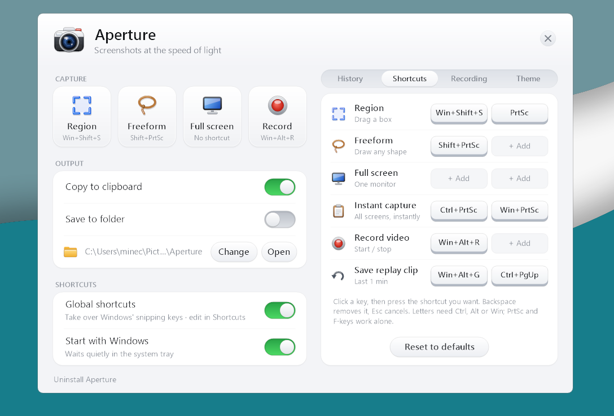

# Aperture

An ultra-lightweight screenshot and screen-recording tool for Windows 10/11, written in Rust with raw Win32, GDI+, Direct3D 11 and Media Foundation.
It has no UI framework and no third-party runtime dependencies. It ships as a single exe of about 760 KB that uses about 3-6 MB of RAM while idle.



## Build

```
cargo build --release
copy target\release\Aperture.exe dist\Aperture-Setup.exe
```

- `Aperture.exe --portable` runs without installing, which is handy for development.
- `Aperture.exe --record` / `--clip` / `--region` / `--freeform` / `--full` send commands to the running Aperture.
- `Aperture.exe --probe video.mp4 frame.png` (developer tool) decodes a frame from a video to check recordings.
- `Aperture.exe --write-icon assets\aperture.ico` regenerates the camera icon from the vector drawing code in `src/icons.rs`. Rebuild afterwards to embed it.

### Linux (Debian, Wayland + X11)

Everything works on Linux: screenshots, annotation, history, settings, tray, global shortcuts, screen recording and replay clips.

```
sudo apt install build-essential curl
curl --proto '=https' --tlsv1.2 -sSf https://sh.rustup.rs | sh   # if you don't have Rust yet
cargo install cargo-deb
cargo deb                                     # builds target/debian/aperture_*.deb
sudo apt install ./target/debian/aperture_*.deb
```

No `-dev` packages are needed: the window system libraries are loaded at runtime. The package pulls in everything else it needs.

- `aperture` opens settings (and starts Aperture in the background). `aperture --region` / `--freeform` / `--full` / `--instant` / `--record` / `--clip` go to the running copy, so they also work as custom shortcuts in your desktop's keyboard settings.
- **Video** is encoded by GStreamer (installed with the package), on the graphics card through VA-API when available, otherwise with x264. On Wayland your desktop asks which screen to share the first time and remembers it. Stop a recording with the same shortcut, the tray menu or, on X11 region recordings, the stop pill.
- **Wayland:** capture goes through the desktop's screenshot portal, which may ask for permission the first time. Global shortcuts use the desktop's shortcut service (KDE Plasma, GNOME 48+); on older GNOME, add custom shortcuts that run the commands above.
- **X11:** capture and shortcuts work directly, without prompts.
- **GNOME tray icon:** needs the AppIndicator extension (`gnome-shell-extension-appindicator`).

#### Code layout

Shared code lives in `src/` (settings, icons, palettes, history, image maths). `src/win/` is the Windows backend and `src/linux/` is the Linux backend. Each build compiles only its own backend and that backend's crates.

## What if I wanted to install instead? (Installation)

1. Go to **[Releases/latest](https://github.com/raiden-evil/aperture/releases/latest)** (or look at Releases on side of Aperture repo and click the latest build). The install includes binary for installer, if you don't trust it, just build it yourself following the build instructions above.

You can also download the Installer from **`dist/Aperture-Setup.exe`** (a single file)
2. Double-click it and press **Install**. No admin rights are needed.
   - Windows SmartScreen may say "Windows protected your PC" because the exe isn't code-signed.
     Click **More info → Run anyway**.

The installer will then do:
- copies Aperture to `%LOCALAPPDATA%\Programs\Aperture`
- adds a Start-menu shortcut and starts Aperture with Windows
- registers it in **Settings → Apps → Installed apps**, where it can be uninstalled
- turns off Windows' "Print Screen opens Snipping Tool" so Aperture handles PrtSc

Running the setup again updates an existing install and keeps your settings.

## Uninstall

Use any of these:
- **Settings → Apps → Installed apps → Aperture → Uninstall**
- the **Uninstall Aperture** link at the bottom of the Aperture window
- `Aperture.exe --uninstall`

Uninstalling removes the app, its shortcuts, its autostart entry and its clipboard history.
Windows' own screenshot shortcuts come back. Screenshots you saved are kept.

## Shortcuts

All shortcuts can be changed in **Settings → Shortcuts**. Each action has two slots.
Click a key box and press the new combination: Backspace removes a shortcut and Esc cancels.
Letters and numbers need Ctrl, Alt or Win. PrtSc and the F-keys also work on their own.
**Full screen** (the monitor under the cursor, with editing) has no shortcut by default.

The defaults are:

| Keys | Action |
|---|---|
| **Win+Shift+S** / **PrtSc** | Region capture |
| **Shift+PrtSc** | Freeform (lasso) capture |
| **Ctrl+PrtSc** / **Win+PrtSc** | Instant full screen (all monitors) |
| **Win+Alt+R** | Start / stop a screen recording |
| **Win+Alt+G** | Save a replay clip (when Replay clips is on) |
| Alt+PrtSc | Left to Windows (active window) |

**In the capture overlay**

- **Choosing an area:** `R` Region · `F` Freeform · `W` Full screen · `V` Record video. Click without dragging to capture the whole monitor.
- **Tools:** `T` Text · `B` Blur · `X` Black bar · `A` Arrow · `L` Line · `P` Pencil (freehand) · `C` Change color.
- **Editing:** `Ctrl+Z` Undo · Right-click to reselect.
- **Finishing:** `Enter` or double-click to copy (and save, if that's on) · `Ctrl+S` Save to folder · `Esc` Cancel.

## Tray & settings

Aperture's camera icon sits in the taskbar's system tray.
- Left-click it to open Settings & History.
- Right-click it for quick captures or to quit.

Settings has these options:
- Copy to clipboard: on or off.
- Save to folder: on or off. The default folder is `Pictures\Aperture`. Use **Change** to pick another folder and **Open** to view it.
- Global shortcuts: on or off.
- Start with Windows: on or off.

The right side has four tabs:
- **History:** your last 10 captures. Click one to copy it again, or right-click it to open the file.
- **Shortcuts:** change any shortcut.
- **Recording:** Replay clips on or off, clip length (15 seconds to 30 minutes), 30 or 60 fps, and the video folder (default `Videos\Aperture`).
- **Theme:** Light (the default), Dark, or Charcoal (pure black, for OLED screens).

## Recording

- **Record a video:** press **Win+Alt+R**, or click the red record button in the capture bar, then drag an area (or click for the whole monitor).
  A small timer appears with a stop button, and a red frame marks the area. Neither shows up in the video.
  Stop with the button or the same shortcut. The MP4 is saved to your video folder and, if "Copy to clipboard" is on, copied as a file so you can paste it into a chat.
- **Replay clips:** when switched on in Settings → Recording, Aperture keeps the last N minutes of your main monitor in short temporary files.
  Press **Win+Alt+G** to save them as one MP4.
  While it's switched off, nothing runs and no memory is used.
- Videos use your graphics card's hardware H.264 encoder. Frames where nothing on screen changed are skipped, so a still desktop costs almost nothing.
- There's no audio yet. Recordings cover one monitor at a time.

## HDR / OLED

On monitors with Windows HDR turned on, screenshots and videos are captured as real HDR data.
They're converted using your "SDR content brightness" setting, and bright highlights are compressed instead of blown out.
Pictures then look like the screen instead of over-bright. SDR monitors use the normal fast path.

Settings and history live in `%APPDATA%\Aperture`.

## Notes

- Windows doesn't let normal apps see keys pressed inside an *admin* window. While an elevated app has focus, Windows' own Win+Shift+S runs instead.
- Captures are physical-pixel exact on mixed-DPI multi-monitor setups.
- There's not setting to change resolution for recording, only 30/60 FPS for now.

## The Philosophy behind Aperture & Upcoming Features

**Vibe Coded Slop?**

Yes, it is. I vibe coded this app to serve as solution over my personal issues with Windows' Snip being very slow and unstable. It didn't do what I want it to do, it didn't have features that KDE Plasma's Screenshot does. If you don't like that, no need to use it :)  I hope this can serve as solution for many people like me, or just wanted a lightweight alternative.

**The Core Philosophy**

Aperture's many features is modeled after KDE Plasma's Screenshot, and the UI design is created with the goal to be: ultra lightweight, simple, and sleek. No need for fancy decoration, but still serves a functional purpose in both look and feeling.

The icons & roundness is both mix of modern UI design and skeuomorphic icon design. I did it like this because that's what I like. If you don't like anything about it, you can take the source code and modify it to your liking. That's why Aperture is open source, for modifaction & security purposes.

If you don't feel safe or doesn't trust this program, simply read source code, build it yourself instead of using the readily avaliable binaries. 

**Planned Features?**

I might be adding settings for changing resolution on recording, as well allow for more freedom in changing time for Replay clips to be whatever instead of incremental increase/decrease.

Like I had previously said, Aperture is designed to solve my personal problems. Beyond all current features of Aperture, I don't really think there's anything else that I feel I should add or even have any idea in general. I feel all features that's currently avaliable in 1.0.2 of Aperture should enough for everybody. Screenshotting, recording, replay clips of something from past, with quick tools for modifying images & clipboard history, settings to change keybinds. I think this app really have everything that is probably needed for fast & functionally taking pictures/videos.